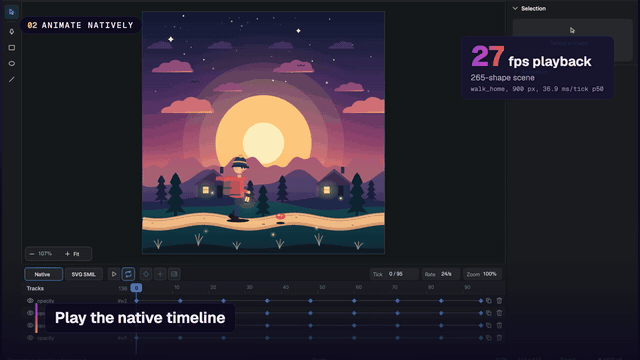

<p align="center">
  
</p>

<h1 align="center">Vexel</h1>

<p align="center"><strong>Vector animation for macOS your agent can edit live.</strong></p>

<p align="center">
  <a href="https://github.com/megasoft1978/vexel/actions/workflows/ci.yml"></a>
  <a href="https://github.com/megasoft1978/vexel/tags"></a>
  <a href="LICENSE"></a>
  
  
</p>

<p align="center">
  <a href="https://megasoft1978.github.io/vexel/">Website</a> ·
  <a href="docs/mcp.md">MCP docs</a> ·
  <a href="CHANGELOG.md">Changelog</a>
</p>

<p align="center">
  <a href="docs/media/web_demo.mp4"></a>
</p>

Vexel is a native macOS vector drawing and animation editor written in Rust: an
owned XML/SVG parser and rasterizer, a custom-drawn interface, a native
animation timeline, and a local MCP server so an agent (Codex, Claude Code) edits
the same document you have open. Alpha software.

## Why Vexel

- **Agent and human share one document.** The app is the MCP server; edits from
  an agent appear in the open window and land in the same undo history.
- **Animation is first-class.** Native timeline with property keys, cubic-bezier
  easing, loop and duration, exported to GIF, APNG, PNG frames, H.264/HEVC video and HEVC with alpha.
- **Native and self-contained.** Rust, owned SVG decoder and renderer, AppKit
  window. No Electron, no web view.

## See it

The [34 s demo video](docs/media/web_demo.mp4) (silent, burned-in captions; also on the [website](https://megasoft1978.github.io/vexel/#demo)) shows an agent driving the open document, the native timeline, exports and the numbers below. The full-length master stays local and is not committed ([docs/demo/README.md](docs/demo/README.md)).

| Walk home | Night boat | Show |
|---|---|---|
|  |  |  |

## Features

"Done" means implemented and covered by tests; live-window checks are listed
separately in [docs/ui/live-check.md](docs/ui/live-check.md) and
[docs/e2e-ui.md](docs/e2e-ui.md).

| Feature | Status | Notes |
|---------|--------|-------|
| SVG open and render | Partial | Owned decoder covers a subset. Internal DOCTYPE entities supported; arcs (`A`/`a`) unsupported. Corpus: 21/39 files rendered in the last recorded run ([HANDOFF.md](HANDOFF.md)). |
| Path data | Partial | Q/q, T/t and S/s commands accepted with correct bounds; arcs unsupported. |
| `.vexel` project save and reopen | Done | V1 slice ([HANDOFF.md](HANDOFF.md)). |
| Native Open / Save / Save As panels | Partial | Save panel opens once on Cmd+S. Open panel not verified ([live-check.md](docs/ui/live-check.md)). |
| Canvas editing | Partial | Select with eight resize handles, rotate with live preview, grouping, nested `<use>`, inspector fill/stroke/opacity/transform controls. Pointer drawing not yet verified on a real window ([HANDOFF.md](HANDOFF.md)). |
| Undo / Redo | Done | Journal edit groups for atomic undo. Verified on the real window ([live-check.md](docs/ui/live-check.md)). |
| Animation timeline and playback | Partial | Key editing with cubic-bezier easing, loop, duration; Add key (K) at the playhead and per-key easing. Broader authoring is still open ([HANDOFF.md](HANDOFF.md)). |
| Export: GIF | Done | Native timeline; loops over 120 frames stride-sampled. Export-to-file on quit not yet verified ([live-check.md](docs/ui/live-check.md)). |
| Export: APNG | Done | `apng` via `export_animation` (MCP). |
| Export: PNG frame sequence | Done | `frames` via `export_animation` (MCP). |
| Export: MP4 / MOV | Done | H.264 or HEVC from a native timeline, BT.709 (AVFoundation). Export is 1.8-2.9x faster than earlier builds (see Performance). |
| Export: HEVC with alpha | Done | `mov` container with `alpha` option. |
| PNG render | Done | `vexel-png`; `render_png` over MCP. |
| Text (CoreText) | Done | ([HANDOFF.md](HANDOFF.md)). |
| Masks, opacity groups, patterns, filters, markers, stroke dashes | Done | Dashes are deferred in animation frames ([HANDOFF.md](HANDOFF.md)). |
| Local MCP server | Partial | 56 live-preview tools. The `batch` tool applies ordered scene and timeline operations as one undo step (atomic by default). Tool reference in [docs/mcp.md](docs/mcp.md). A real Codex session driving Vexel over MCP is recorded in [docs/demo/](docs/demo/live-session.mp4); Claude Code setup is documented but not verified. |
| Gradients (linear, radial) | Done | Fills render in the canvas, playback and exports; inspector gradient fill control; `gradient_add` over MCP. |
| Blend modes, JPEG, interlaced PNG | Planned | Typed disclosures, not rendered ([HANDOFF.md](HANDOFF.md)). |
| Documents over 32 MiB | Planned | Refused by design; needs streaming decode ([BLOCKERS.md](BLOCKERS.md)). |
| Signing, notarization | Planned | Owner-gated ([HANDOFF.md](HANDOFF.md)). App icon is new (generated artwork); bundle id is still a placeholder. |

## Quick start

Requirements: Apple Silicon Mac, macOS 13 or later, rustup (the toolchain is
pinned in `rust-toolchain.toml`). There is no signed release; build from source.

```sh
cargo build --release -p vexel-app
./build/rust/aarch64-apple-darwin/release/vexel rust/fixtures/v1/anim/loop.svg   # open an SVG
./build/rust/aarch64-apple-darwin/release/vexel --mcp-preview --grant-dir /Users/me/Artwork   # serve MCP on stdio
```

Register the app as an MCP stdio server. Use absolute paths.

**Codex**, in `~/.codex/config.toml`:

```toml
[mcp_servers.vexel]
command = "/absolute/path/to/vexel/build/rust/aarch64-apple-darwin/release/vexel"
args = ["--mcp-preview", "--grant-dir", "/Users/me/Artwork"]
startup_timeout_sec = 10
tool_timeout_sec = 60
```

**Claude Code** (documented, not yet verified in a recorded session):

```sh
claude mcp add vexel --scope user -- \
  /absolute/path/to/vexel/build/rust/aarch64-apple-darwin/release/vexel \
  --mcp-preview --grant-dir /Users/me/Artwork
```

Non-interactive `codex exec` and a project `.mcp.json` variant are in
[docs/mcp.md](docs/mcp.md).

## Performance

Measured with the in-repo bench harness, before vs. after the playback and
render optimization work (outputs are byte-identical; differential tests guard
that). One Apple Silicon machine; your numbers will differ.

| Scene | Before | After | Speedup |
|---|---|---|---|
| walk_home playback (265 shapes), time per frame | 1450 ms | 37 ms (about 27 fps) | 39x |
| Stroke-heavy render, 1000 shapes at 2048 px | 24.8 s | 2.7 s | 9.2x |
| Mixed scene render, 5000 shapes | 2245 ms | 585 ms | 3.8x |
| Exports (H.264, GIF, APNG and more) | n/a | n/a | 1.8-2.9x |

Reproduce:

```sh
cargo run -p vexel-dev -- bench
```

## How MCP works

- `vexel --mcp-preview` runs the GUI app and serves JSON-RPC over stdio.
- The client launches that command; the window stays live while it is connected.
- 57 tools: document, tree and element editing, grouping, undo/redo, `batch`,
  native timeline, `animation_control`, `export_animation`, `render_png`.
- `--grant-dir <dir>` (repeatable) is the only file access the tools get.
- Per-session budget is 600 requests per minute. Details: [docs/mcp.md](docs/mcp.md).

## Status and limitations

Alpha, macOS only (Apple Silicon, macOS 13+).

- Arc path commands (`A`/`a`) are unsupported.
- Corpus: 21/39 files rendered in the last recorded run, not re-counted since
  later fixes. Known failing or deferred: columbiarivermap, corsica (`<tspan>`
  text), ideogram (clip aggregate cap), france-osm (render limit)
  ([STATUS.md](STATUS.md)).
- Not signed with a Developer ID and not notarized; build from source.
- No GUI end-to-end run on hosted CI; the real-window script is
  [docs/e2e-ui.md](docs/e2e-ui.md), run by hand.
- Documents over 32 MiB are refused by design ([BLOCKERS.md](BLOCKERS.md)).
- MCP long-running progress and cancellation are not implemented.
- Benchmarks: the table in Performance is one machine, one run; hosted CI timing is not reproducible.

## Roadmap

From [STATUS.md](STATUS.md), in order:

1. Async export.
2. SVG corpus fidelity (21/39) and large-document design.
3. Recovery and compatibility, performance, accessibility.
4. Python tooling ported to Rust.
5. Final UI/E2E, packaging (owner-gated: signing, bundle id), showcase video.

## Contributing

- Keep source files under 800 lines.
- One writer per module; shared manifests, locks, interfaces and ledgers change
  only through the coordinator ([AGENTS.md](AGENTS.md)).
- Verify before sending changes:

```sh
cargo check --workspace --locked
cargo test --workspace --locked
python3 -m unittest tests.test_ledger tests.test_wo_runner
```

## Documentation

- [STATUS.md](STATUS.md): current status (live source of truth)
- [CHANGELOG.md](CHANGELOG.md): changes since `v1.0.0-alpha`
- [HANDOFF.md](HANDOFF.md): earlier status snapshot
- [BLOCKERS.md](BLOCKERS.md): known blockers and gaps
- [docs/mcp.md](docs/mcp.md): MCP server and tool reference
- [docs/demo/](docs/demo/storyboard.md): recorded Codex live session and storyboard
- [docs/ui/live-check.md](docs/ui/live-check.md): live-window verification
- [docs/e2e-ui.md](docs/e2e-ui.md): real-window UI e2e script and manual checklist
- [docs/product/vexel-goal-and-delivery-plan.md](docs/product/vexel-goal-and-delivery-plan.md): plan
- [ADR-0018](docs/adr/0018-product-goal-and-completion-gates.md): product goal and completion gates

## License

Vexel is distributed under the Mozilla Public License 2.0 (MPL-2.0). See
[`LICENSE`](LICENSE).
