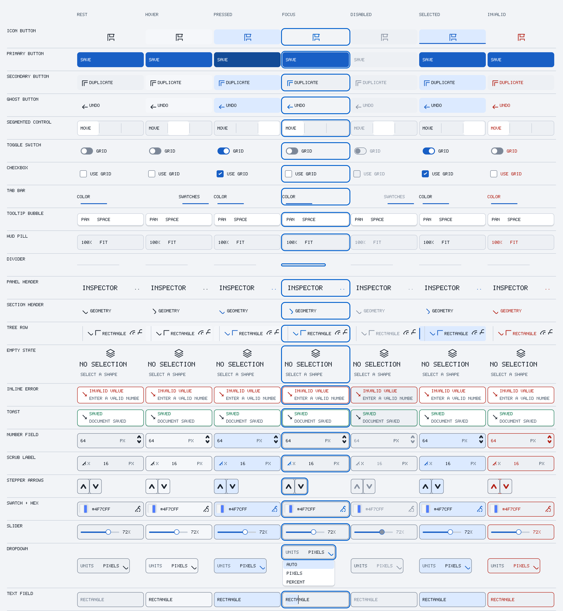
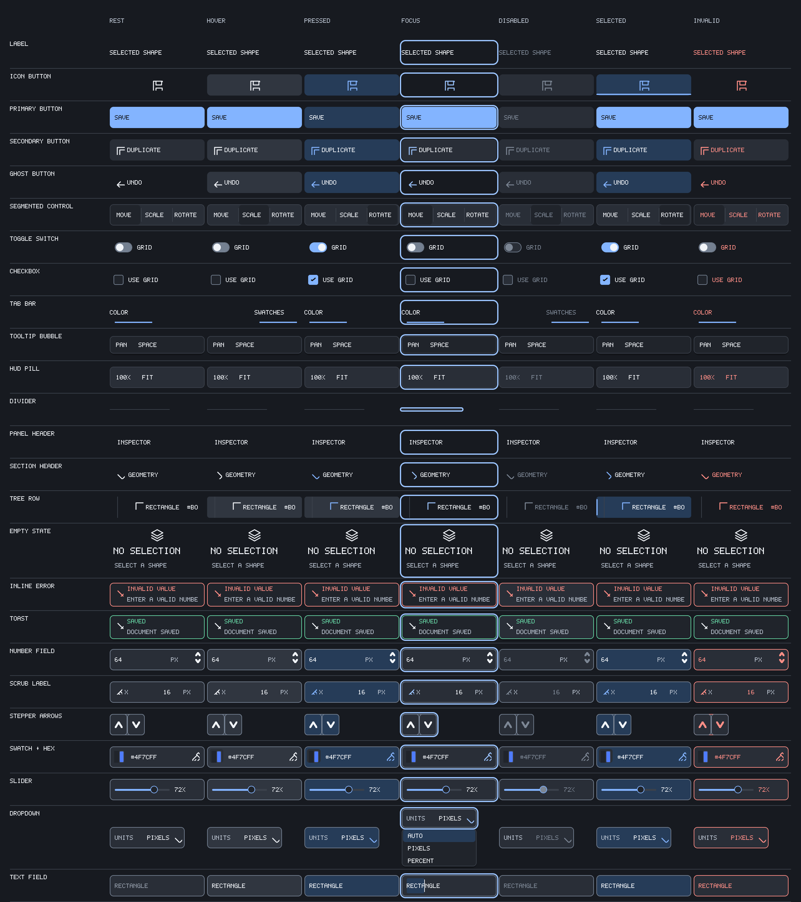
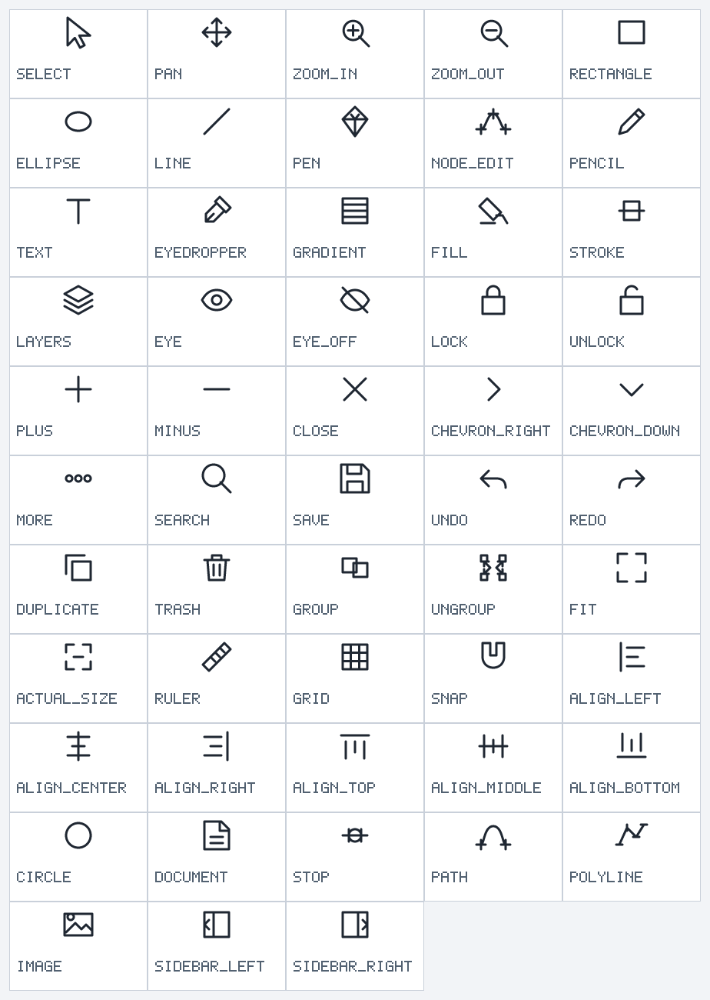
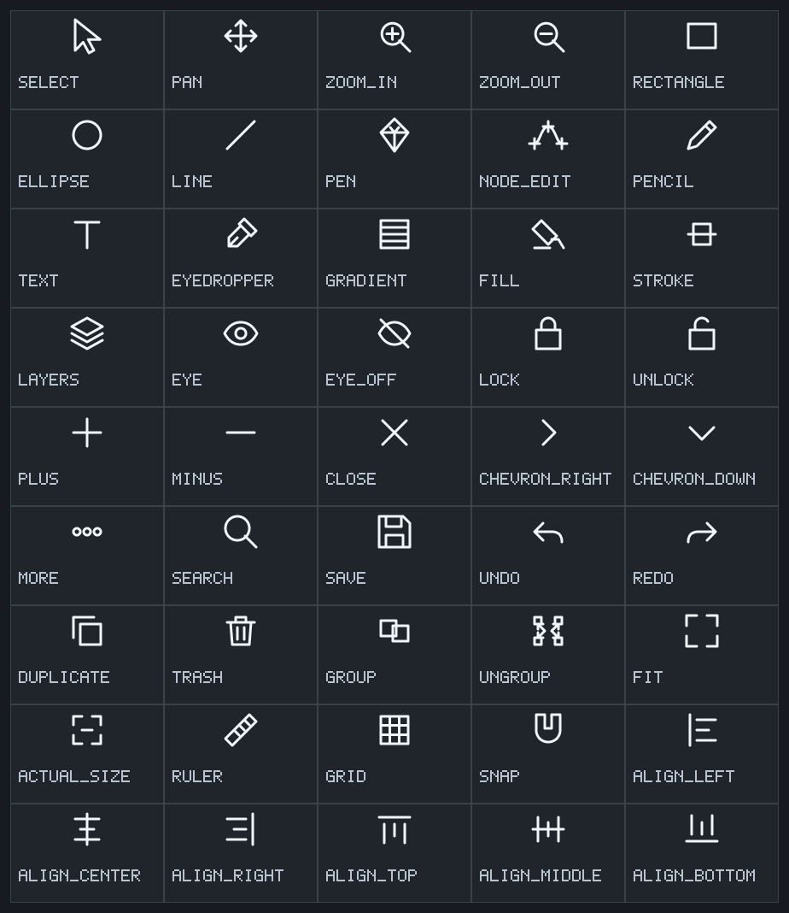

# UI lane

## Task workspaces

The editor chrome has four Blender-style task workspaces, shown as a tab strip in
the band under the toolbar: `Draw`, `Nodes`, `Animate` and `Inspect`. A workspace
only selects which panes are visible and which inspector section is expanded; it
never changes the editing model or the document bytes. `Control-PageDown` and
`Control-PageUp` cycle forward and backward with wrap (`Control-Tab` works as an alias).

- `draw` — structure panel, inspector, inspector section `Geometry`, no timeline
- `nodes` — structure panel, inspector, inspector section `Geometry`, no timeline
- `animate` — structure panel, inspector, inspector section `Appearance`, timeline visible
- `inspect` — structure panel, inspector, inspector section `Attributes`, no timeline

The active workspace is stored in the macOS defaults under
`VexelSettings.v1.workspace` as the workspace name (`draw`, `nodes`, `animate`,
`inspect`). It is only restored when the existing `rememberWorkspace` preference
is on; an unknown or missing name falls back to `draw`.

The status bar is a single bar with Blender's three regions: the active-tool hint
on the left, the operation report (with a Cancel button while an operation runs)
in the centre, and the save state, selection count and zoom on the right. The
tool hint is not duplicated anywhere else in the chrome.

See [the w4-ui style implementation](../lanes/ui-style.md) for the production
editor palette, layout, CoreText path, accessibility bridge, computed contrast
report, new 1×/2× style goldens, and remaining integration limits.

The w7 UIKit adds a reusable design-token layer, 53 static path icons, bounded
input state machines, and custom-painted widget primitives. The gallery images
show all 25 components across seven visual states. Their 2× exports are the
human-review images; all four combinations of theme and backing scale are
tracked in `tests/ui/uikit-golden/`.









`uikit-contrast-report.json` records computed sRGB relative-luminance ratios
for light and dark appearances, each at standard and increased contrast. The
contract test checks text at 4.5:1 or greater, functional edges at 3:1 or
greater, and semantic status colors at 4.5:1 or greater.

The gallery renderer uses the deterministic scalar label callback so its PNGs
are stable in tests. The application chrome uses an injected CoreText callback
with SF Pro Text and SF Mono, fitted labels, and the component type scale.
Numeric values request the monospaced family and headings request semibold.
The gallery is a component showcase, not a screenshot of the application
chrome. Modern dark and light editor chrome is covered by
`tests/editor/chrome-golden/`.

To rebuild and verify the galleries after changing tokens or components:

```sh
cmake --build build/mac-debug --target ui_gallery ui_icon_gallery
python3 tests/ui/verify_uikit_gallery.py \
  --binary build/mac-debug/bin/ui_gallery \
  --icon-binary build/mac-debug/bin/ui_icon_gallery
```

To intentionally update the newly added PNG fixtures, pass `--update`.

See [editor canvas interaction](editor-interaction.md) for opening fit, live
canvas status, pan/zoom input, selection, transform handles, shape creation,
multi-selection, path editing, snapping, clipboard, PNG, text, keyboard
shortcuts, and current feature limits. The editor selection overlay
has separate dark/light 1×/2× fixtures under `tests/editor/selection-golden/`;
the existing style and chrome fixtures remain unchanged.

The retained tree keeps stable node and parent IDs, full UTF-8 semantic text,
and focus/selection/invalid state. Legacy demo fixtures remain on the scalar
path and are kept separate from the modern macOS editor rendering path.

M6-02 adds widget constructors for buttons, checkboxes, text fields, sliders, and
rows. Tab/Shift-Tab move focus through enabled interactive controls; Enter/Space
activate commands, and Space toggles checkboxes. Stable semantic snapshots copy
node IDs, parent IDs, roles, labels, values, and disabled/checked/focused states.
Semantic group and list labels stay in the accessibility tree without being
painted over their child titles. Hover and pressed states flow through the
viewer event bridge and request a frame redraw.

The editor composes its toolbar, searchable layer tree, type-aware inspector,
text fields, canvas HUD, and status bar from the retained tree. The editor
chrome golden renderer exercises that modern path with injected CoreText while
the legacy style fixtures remain separate. Canvas interaction tests are
headless and inject events directly; the separate maintainer smoke script needs
a macOS desktop session.
